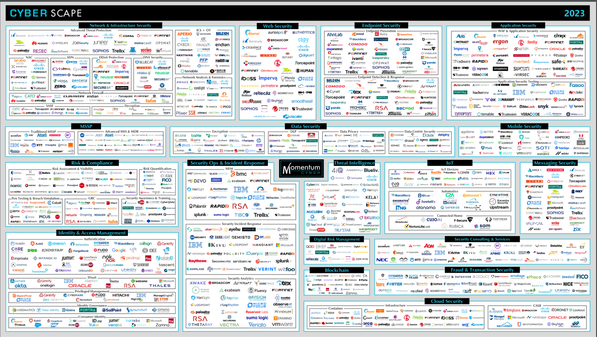

   
   
 CyberScape 2023 

(<a href="https://momentumcyber.com/docs/Monthly/Cybersecurity_Snapshot_May_2023.pdf">https://momentumcyber.com/docs/Monthly/Cybersecurity_Snapshot_May_2023.pdf</a>)

In the vast cybersecurity landscape, many focus areas exist, each crowded with competitive products. This raises a critical question: if current endpoint security solutions are lacking effectiveness (as discussed in my previous blog, "Where Are We at with Endpoint Security"), should we consider sidelining endpoint security altogether? Imagine relying solely on the best network and infrastructure security, robust cloud security for central servers, advanced mobile security, stringent data security measures, and sophisticated identity management systems like OAuth. Can these strategies alone thwart cyber attackers?

The short answer is no. <u><em>When an endpoint is compromised, attackers gain the same level of access as legitimate users.</em></u> They can capture what users see (via screen recording), log keystrokes, modify files, and even steal biometric data. In essence, attackers can impersonate users, compromising interactions with remote servers.

**Shift to Zero-Trust Architecture requires but misses endpoint security**

Despite this, the cybersecurity industry, perhaps driven by market competitiveness, is <u>heavily</u> investing in developing Zero-Trust Network Architecture (ZTA). <u>ZTA</u> works by <u>granting access</u> to networked resources only after verifying <u>the identity</u> <u>and context</u> <u>of an endpoint</u>, such as its location, device, and credentials [1]. However, without effective endpoint security, ZTA's ability to accurately assess endpoints is fundamentally flawed. Attackers can spoof legitimate users and manipulate the endpoints' context. For instance, if a C-level executive’s computer <u>is</u> <u>compromised</u>, <u>the attacker gains</u> access to as many organizational files as the executive.

ZTA's strategy of using agents within operating system kernels is not foolproof, as these kernels are complex and prone to vulnerabilities. Moreover, once attackers compromise these kernels, the agents themselves become insecure. The latest ZTA products propose an "agentless" approach, such as Remote Browser Isolation (RBI), which doesn't require installation on user endpoints. However, this approach assumes <u>that</u> user endpoints are vulnerability-free, a condition <u>easily breached by attackers</u> through methods like compromised USB drives or <u>accessing</u> unsecured websites.

[1] “Zero Trust Is an Initial Step on the Roadmap to CARTA”, Gartner, 10 December 2018.
