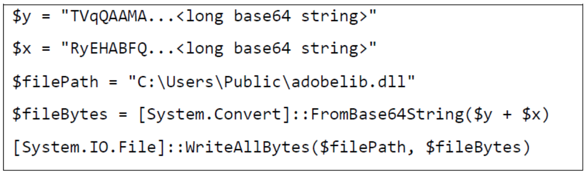

*Published: December 17, 2023*

*Original article: [Superymk's Thoughts on Cybersecurity](https://superymk.wordpress.com/2023/12/17/recent-incident-lockbit3-0-nov-2023/)*

**Incident:**

“The U.S. financial services division of Chinese bank ICBC was hit by a cyberattack that reportedly affected the trade of U.S. Treasurys.” [2]

“Security expert have said ransomware from the hacking group LockBit was used to carry out the cyberattack on ICBC.” [2]

**Impact:**

“LockBit 3.0 affiliates have conducted attacks against organizations of varying sizes across multiple critical infrastructure sectors, including education, energy, financial services, food and agriculture, government and emergency services, healthcare, manufacturing, and transportation.” [1]

**Cause:**

The ransomware LockBit 3.0 exploits a vulnerability (CVE-2023-4966) of an IT infrastructure software (Citrix NetScaler web application delivery control (ADC) and Gateway appliances) to obtain initial access to organizations. Then, it implants malware that bypasses today’s endpoint security products to harvest credentials, move laterally, and access data and resources. [1].

<u>*How to exploit CVE-2023-4966?*</u>

“After acquiring access to valid cookies, LockBit 3.0 affiliates establish an authenticated session within the NetScaler appliance without a username, password, or access to multi-factor authentication (MFA) tokens [T1539]. Affiliates acquire this by sending an HTTP GET request with a crafted HTTP Host header, leading to a vulnerable appliance returning system memory information [T1082]. The information obtained through this exploit contains a valid NetScaler AAA session cookie” [1].

<u>*How to bypass endpoint security?*</u>

LockBit 3.0 runs a PowerShell script to generate the command and control (C2) file `adobelib.dll` by “concatenating two base64 strings together, converting them to bytes, and writing them to the designated file path.” [1]

   
   
 Code to generate adobelib.dll 

“The resulting file (adobelib.dll) is then executed by the PowerShell script using rundll32. `rundll32 C:\Users\Public\adobelib.dll,main`” [1]

“adobelib.dll will not execute correctly without the 104 hex character key.” [1]

“Following execution, the file attempts to send a POST request to `https://adobe-us-updatefiles[.]digital/index.php` which resolves to IP addresses `172.67.129[.]176` and `104.21.1[.]180` as of November 16, 2023. Although adobelib.dll and the adobe-us-updatefiles[.]digital have the appearance of legitimacy, the file and domain have no association with legitimate Adobe software and no identified interaction with the software.“ [1]

<u>*Why is the incident related to endpoint security?*</u>

Sensitive credentials for lateral movement and sensitive data and resources may be stored on user endpoints.

**Lessons:**

- **Vulnerabilities in IT Infrastructure Software Lead to Significant Losses.** IT infrastructure software, including operating systems, OEM software, and IT management applications, often contains bugs that can take a considerable time to patch. This delay in patching vulnerabilities can be exploited by attackers. They can leverage a single vulnerability across various organizations in different sectors, thereby maximizing their potential for profit.
- **Current Endpoint Security Products are Ineffective.** Modern endpoint security products failed to detect the ransomware and its activities before the incident was discovered.
- **Signed Software and Websites Could be Malicious.** Unfortunately, users and some endpoint security products trust them only because they are signed. This is insecure.
- **Weak Endpoint Protection Increases IT Recovery Post-Breach.** Although the current incident primarily affected organization servers, there’s an elevated risk of collateral damage if the attackers disseminate malware to user endpoints through the breached infrastructure. Such a scenario allows attackers to maintain a persistent presence on compromised user devices, continuously posing threats to the organization’s IT assets and sensitive data.

[1] CISA.gov. “#StopRansomware: LockBit 3.0 Ransomware Affiliates Exploit CVE 2023-4966 Citrix Bleed Vulnerability”. [Source PDF](https://www.cisa.gov/sites/default/files/2023-11/aa23-325a_lockbit_3.0_ransomware_affiliates_exploit_cve-2023-4966_citrix_bleed_vulnerability_0.pdf).

[2] CNBC. “China’s ICBC, the world’s biggest bank, hit by cyberattack that reportedly disrupted Treasury markets”. [Source article](https://www.cnbc.com/2023/11/10/icbc-the-worlds-biggest-bank-hit-by-ransomware-cyberattack.html)
