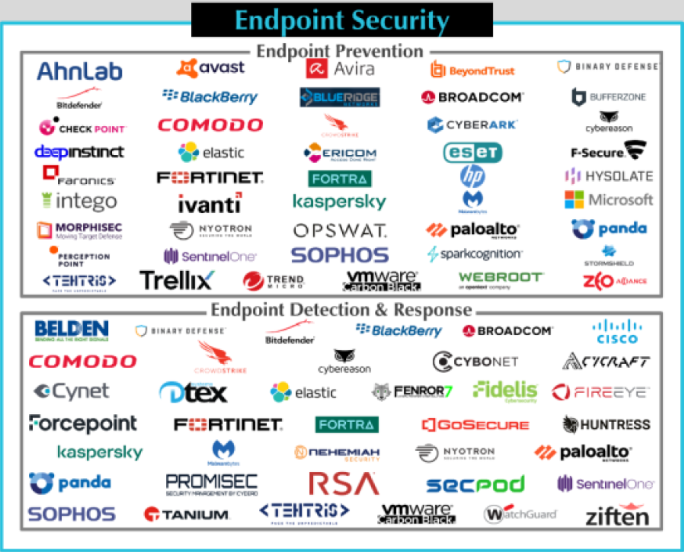
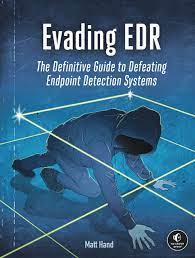

# Where Are We at with Endpoint Security (Part 1)? (2023)

*Published: November 29, 2023*  
*Original post: [Superymk’s Thoughts on Cybersecurity](https://superymk.wordpress.com/2023/11/29/where-are-we-at-with-endpoint-security-part-1-2023/)*

**TL; DR.** No security products today can protect users’ endpoints (e.g., PCs, laptops, mobile phones, tablets) against all malware (e.g., unknown malware). The issue will persist in the next two decades unless the industry rebuilds these systems entirely.

**What is endpoint security?** Essentially, endpoint security is about peace of mind in using computers. It’s the assurance that you can handle sensitive tasks—like banking, accessing medical records, or responding to work emails—without extra learning curves. It’s about intuitive use while safeguarding critical data and applications on your devices, ensuring secure communication across networks, and preserving user experience.

For everyday users, endpoint security prevents cybercriminals from accessing and tampering with personal information like bank details or health records. For businesses, robust endpoint security is the frontline defense against a myriad of cyber threats, including ransomware and data breaches. With the rise of remote work and hybrid work, the need for stringent security that extends beyond office networks is more pressing than ever.

An individual endpoint device compromised outside office networks could spread the malware in the enterprise once the device is brought into the office networks.

**Endpoint security today is insecure.** Today’s tools, predominantly Antivirus and Firewall programs, fall short. They often miss new or even some known malware threats. Even with advancements in AI and machine learning aimed at reducing errors, the goal remains elusive: zero false positive and negative rates to ensure both effectiveness and user convenience.

*CyberScape 2023 ([source](https://momentumcyber.com/docs/Monthly/Cybersecurity_Snapshot_May_2023.pdf))*

Some solutions attempt to isolate downloaded unfamiliar applications using virtualization techniques. These solutions trust the bulky operating systems and applications from trusted vendors. However, “trust” never means malware-free. Hackers could exploit vulnerabilities of trusted software to bypass the isolation enforced in these solutions.

Endpoint Detection and Response (EDR) systems are included in many security suites, yet they too struggle with accuracy. They can’t always correctly discern between normal user behavior and potential threats, which can lead to both missed detections and unnecessary alerts. For example, while a new application execution at 3 AM in a local bar is highly suspicious, it is fairly normal for businessmen from global companies to travel abroad.

The same EDR system may alarm incorrectly without considering the scenarios.

(Meanwhile EDR systems are advertising)

**Zero-Trust Network Architecture (ZTNA) cannot replace endpoint security, period.** ZTNA enforces access control at the network realm boundary based on endpoint context; e.g., user, device, and geographic location. Without endpoint security, ZTNA cannot gather reliable context from users’ endpoints. ZTNA will also fail to differentiate hackers from users. Users and hackers would have the same privilege to access all information via users’ endpoints.
