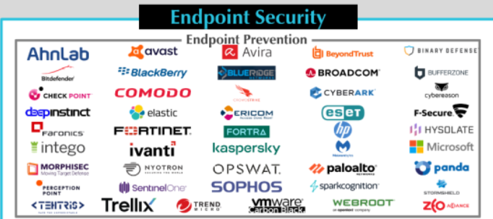

*Published: November 29, 2023*

*Original article: [Superymk's Thoughts on Cybersecurity](https://superymk.wordpress.com/2023/11/29/where-are-we-at-with-endpoint-security-part-2-2023/)*

In this blog, let’s examine some real products:

   
   
 CyberScape 2023: Endpoint Security / Endpoint Prevention 

*CyberScape 2023 ([source: Momentum Cyber](https://momentumcyber.com/docs/Monthly/Cybersecurity_Snapshot_May_2023.pdf))*

Most endpoint prevention products today are based on antivirus, firewalls, patch management, and endpoint detection/response (EDR) approaches. These approaches rely on databases of known malware samples. This reliance presents a significant limitation: they are less effective against new or unknown malware and its variants. As cyber threats evolve rapidly, this gap in defense can be a major insecurity.

Regular tests of antivirus tools, such as those conducted by AV-Test [2], suggest that top antivirus solutions can effectively thwart all known malware samples, including 0-day threats. However, other assessments, like AV Comparatives [1], indicate that even popular antivirus solutions have some level of false negatives (failing to detect malware) and false positives (misidentifying safe files as malware).

These test results, while informative, do not always align with the dynamics of real-world cybersecurity threats. For instance, a single malware breach can disable antivirus protections, paving the way for more malware to compromise the system. All false negatives in AV comparatives [1] could be the start of further breaches. Attackers often test their malware against widely-used security products to increase the success rate of their attacks.

Additionally, the increasing complexity of applications, system software, drivers, and operating systems, often laden with new but insufficiently tested features, provides attackers with more opportunities to penetrate target systems.

Finally, the effectiveness of endpoint security is also influenced by user behavior and systemic issues. User errors, such as incorrect settings or authorization of actions, can weaken security. The lengthy process of fixing software bugs and delays in applying software patches further exacerbate the risks. These factors collectively lower the barrier for attackers to compromise real-world endpoints.

- AhnLab (V3 Endpoint Security)
- AlertLogic (MDR)
- Avast (Avast Business Next-Gen AV)
- Avira (Avira Antivirus for Endpoint)
- Binary Defense (Managed Detection & Response)
  - “Detect and protect from zero-day threats with behavior-based and deception technology”
- Bitdefender (GravityZone UltraPlus/Elite/Enterprise)
- BlackBerry (Spark Unified Endpoint Security Suite)
- Blue Ridge (AppGuard)
  - “The AppGuard lightweight agent sits low at the kernel level and blocks unacceptable actions like code injection, or writing to the registry at the process level”
- Broadcom (Symantec Endpoint Security)
- CheckPoint (SandBlast Next Generation AntiVirus)
- CrowdStrike (Falcon)
- CyberReason (CyberReason Enterprise)
- Deep Instinct (Endpoint Security Software)
- Elastic (Elastic Endpoint Security)
- ESET (Endpoint Security)
- F-Secure (Protection Service for Business, Ultralight)
- Faronics (Faronics Antivirus)
- Fortinet (FortiClient, FortiEDR)
- Intego (VirusBarrier, NetBarrier)
- Ivanti (Ivanti Endpoint Security)
- Kaspersky (Kaspersky Endpoint Security for Windows)
- Malwarebytes (Malwarebytes Endpoint Protection)
- McAfee (McAfee Endpoint Security)
- Microsoft (Windows Security)
- Morphisec (Morphisec Guard)
- Nyotron (PARANOID)
- OPSWAT (MetaAccess)
- PaloAltoNetworks (Cortex XDR)
- Panda (Panda Fusion)
- Perception-Point
  - “7 layers of next-gen static and dynamic engines prevent malicious files, URLs, and social-engineering based techniques”
- SentinelOne (Singularity Complete)
- SOPHOS (Intercept X)
- SparkCognition (DeepArmor)
- Stormshield (Stormshield Endpoint Security)
- TEHTRiS (TEHTRIS Unified Endpoint Security)
  - “This is what we offer you with TEHTRIS UES, our console that unifies and enhances the efficiency of our EDR, EPP and MTD solutions. Equipped with powerful and easy-to-use front-end tools, our UES console will enable you to acquire enhanced cybersecurity action capabilities, whether for a temporary crisis operation or regular monitoring.”
- Trend Micro (Trend Micro XGen)
- Webroot (Webroot Business Endpoint Protection)
- VMWare Carbon Black (VMware Carbon Black Cloud)

[1] “Real-World Protection Test July-October 2023”, [AV-Comparatives](https://www.av-comparatives.org/tests/real-world-protection-test-july-october-2023/)

[2] “The best Windows antivirus software for home users. (October, 2023)”, [AV-TEST](https://www.av-test.org/en/antivirus/home-windows/windows-11/october-2023/)
