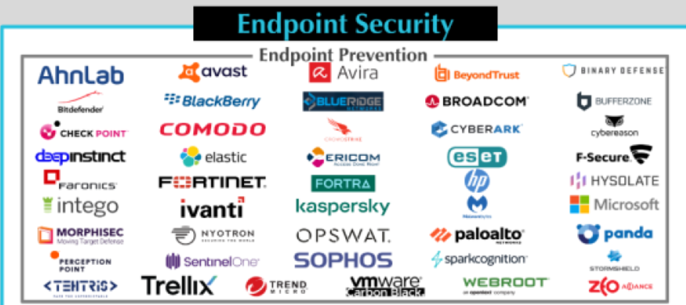

*Published January 18, 2024.*

*Original article: [Superymk's Thoughts on Cybersecurity](https://superymk.wordpress.com/2024/01/18/where-are-we-at-with-endpoint-security-part-3-beyond-malware-detection-2023-continued/)*

   
   
 Endpoint Security — Endpoint Prevention vendors 

Endpoint security based on malware detection (e.g., antivirus tools, firewall) relies on an endless cycle of identifying malware samples, analyzing them, and updating defenses. In the past five years, vendors have started developing endpoint security solutions that isolate unknown files and applications. This method prevents downloaded malware from affecting other software. However, while these products add a layer of protection, they are not entirely foolproof against malware attacks.

These new security solutions operate on a fundamental trust in the operating system (like Windows 10 or MacOS), third-party privileged software, system services, and user-trusted applications (such as Microsoft Word). If any of these trusted systems are compromised, attackers can bypass the software protection measures entirely.

Breaking into these trusted systems is less challenging than one might think. Users typically employ software with massive codebases, such as Windows 10/11, Microsoft Office, and popular web browsers like Chrome or Edge, each containing over 100 million lines of code. These programs include hundreds of third-party libraries with various configurations and potential vulnerabilities.

So attackers can exploit zero-day flaws, unpatched vulnerabilities, deliver malicious patches, spoof trusted sources to send harmful files, and use compromised USB drives or optical disk images.

Products using isolation via virtual machines or containers:

- BufferZone (BufferZone Enterprise Security Solutions)
- Comodo (Advanced Endpoint Protection)
- Kaspersky (Kaspersky Secure Hypervisor)
- Perception Point (Hysolate)
  > “At Hysolate, we’re revolutionizing the endpoint by putting a hypervisor below (as opposed to within) the OS, just like Microsoft, VMware and Xen have been doing with servers for almost two decades. This important difference is the key. By abstracting the primary client OS environment that end-users access, we’re able to provide an unprecedented level of endpoint security and manageability.”
- HP/Bromium (SureClick Enterprise/Security Platform)
- Qubes OS

Microsoft Virtualization-Based Security (VBS) is different from other approaches. It protects a few sensitive Microsoft services from all other software and operating system components. However, it does not extend this protection to sensitive user applications.

One another trend of isolation approaches is to use hardware enclaves (e.g., Intel Software Guard eXtensions, AMD Secure Encrypted Virtualization). While they are good at protecting codes and memory data, they cannot host general sensitive user applications requiring peripheral devices; e.g., keyboards. Solving this problem requires special devices or CPU modification of hardware enclaves.
